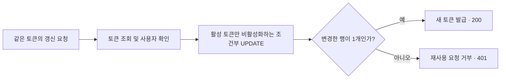
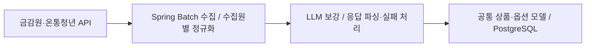
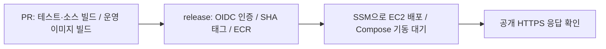
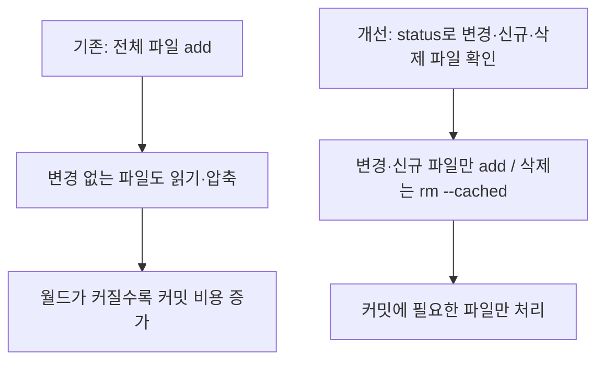

# 최유렬 | Backend Developer Portfolio

**현대오토에버 · 수출 물류 시스템 개발 및 운영 / 디지털 컨텐츠 관리 시스템(DCM) 운영**

Java와 Spring으로 인증·인가와 외부 데이터 수집을 구현했습니다. 중복 요청에서는 데이터 상태가 한 번만 바뀌도록 처리하고, 배포 실패와 성능 저하는 재현 조건을 만든 뒤 수정 결과를 확인했습니다.

[GitHub](https://github.com/yuyeol3) · [개발 블로그](https://yuyeol3.github.io/)

## 핵심 경험

| 경험 | 직접 수행한 일 | 확인한 결과 |
| --- | --- | --- |
| Y-Fin · 인증 및 데이터 처리 | Refresh Token 동시성 수정, 금융 데이터 수집·정규화, LLM 호출 실험 | 토큰 갱신 10개 요청에서 성공 1건·401 응답 9건. 동일한 금융상품 97건의 배치 시간 38~48% 단축 |
| 카카오테크캠퍼스 · CI/CD 및 AWS 배포 | PR 검증과 ECR·SSM 배포 경로 구축, Docker 빌드 실패 대응 | 배포에서만 발견되던 오류를 PR 단계에서 재현하고, 수정 후 3개 구성요소 빌드 통과 |
| mc-distributed · 파일 저장 성능 | 스냅샷 기록·재생으로 병목 분석, 변경 파일만 stage하도록 개선 | 조정용 재생의 커밋 시간 0.87→9.7초 증가를 0.49~1.2초 범위로 완화. 별도 검증용 재생 0.37~0.91초 |

## 지원 직무와 연결되는 역량

| 직무에서 요구하는 역량 | 프로젝트 근거 |
| --- | --- |
| Java·Spring Boot·REST API, 인증과 보안 | Y-Fin의 OAuth2·JWT·Spring Security 인증, 사용자·상품 API |
| 관계형 DB와 데이터 처리 | PostgreSQL·JPA 기반 토큰 상태 변경, Spring Batch 외부 API 수집·정규화 |
| AWS·컨테이너·CI/CD | 카테캠의 EC2·Docker Compose, GitHub Actions·ECR·SSM 배포 |
| 안정성·성능 개선 | 토큰 중복 갱신 방지, 배포 환경 차이 재현, 파일 커밋 비용 분석 |
| Git 협업·변경 및 배포 관리·검증 | 팀 PR에 테스트와 이미지 빌드 적용, 커밋 SHA 기반 이미지 추적, 수정 전후 실행 기록 |

수출물류 직무에는 서버 로직·데이터 연계·클라우드 배포 경험을, DCM 직무에는 인증·성능·변경 관리 경험을 중심으로 제시합니다.

## 목차

1. [Y-Fin](#1-y-fin): 토큰 갱신 동시성 / 외부 금융 데이터 처리
2. [카카오테크캠퍼스 팀 프로젝트](#2-카카오테크캠퍼스-팀-프로젝트): 배포 실패 재현과 CI 보완
3. [mc-distributed](#3-mc-distributed): 스냅샷 커밋 병목 분석
4. [추가 기술 경험](#추가-기술-경험)

---

## 1. Y-Fin

**사용자의 소득·나이·가구 조건에 맞는 금융상품을 찾고 우대금리 조건을 확인하는 서비스**

| 항목 | 내용 |
| --- | --- |
| 기간 / 인원 | 2026.03 ~ 진행 중 / 5인 팀, 백엔드 2인 |
| 본인 역할 | 인증·인가 기반 및 데이터 수집기 구축, 상품·공급자 API 개발, 추천 로직 유지보수·리팩터링 |
| 주요 기술 | Java 21, Spring Boot, Spring Security, JPA, Spring Batch, PostgreSQL, Gemini |
| 데이터 범위 | 은행상품 328건 + 정부 정책상품 63건, 총 391건 정규화 |
| 수상 | 제7회 PNU 창의융합AI해커톤 창업트랙 최우수상 |
| 코드 | [서비스 백엔드](https://github.com/ApptiveDev/Fin-BE) / [수집기](https://github.com/ApptiveDev/Fin-API) / [해커톤 버전](https://github.com/PNU-2026-AI-Hackathon/pnuai-c-07-finfin2) |

### 사례 1 · 중복 토큰 갱신을 DB 상태 변경으로 제어

**문제.** 같은 Refresh Token으로 요청이 겹치면 두 요청이 모두 기존 토큰을 조회했습니다. 이후 토큰 삭제·재발급이 충돌하면서 인증 실패가 500 오류로 처리됐습니다.

**해결과 판단.** 조회 결과만으로 재발급을 결정하지 않고, `isActive = true` 조건을 만족하는 토큰을 비활성화하는 UPDATE를 실행했습니다. 변경한 행 수가 1개인 요청만 새 토큰을 발급하도록 했습니다. 같은 토큰에 대한 처리 여부를 DB에서 결정해 애플리케이션의 조회·삭제 사이에 생기던 경쟁을 제거했습니다.

**결과와 검증.** PR에 첨부한 10개 요청 실행 결과에서 **200 응답 1건, 401 응답 9건**을 확인했습니다. 재사용 요청을 서버 내부 오류와 구분해 처리했습니다. 이 기록은 해당 재현 시나리오의 결과입니다.

**근거:** [동시성 수정 PR #9 — 코드와 요청 결과](https://github.com/ApptiveDev/Fin-BE/pull/9) · [인증 기반 PR #3](https://github.com/ApptiveDev/Fin-BE/pull/3) · [인가 예외 처리 PR #11](https://github.com/ApptiveDev/Fin-BE/pull/11)

### 사례 2 · 외부 금융 데이터 정규화와 LLM 지연 분석

**문제.** 외부 API마다 데이터 구조가 달랐고, 우대금리의 일부 조건은 줄글로 제공됐습니다. 이를 구조화하는 LLM 호출에서 약 60초 뒤 timeout이 발생하거나 응답 파싱이 실패했습니다. 배치 전체 시간만으로는 어느 상품의 어떤 호출이 지연되는지 판단하기 어려웠습니다.

**해결과 판단.**

- 수집원별 구조 차이를 정규화 단계에서 처리하고 공통 상품·옵션 모델로 저장했습니다. 수집 대상에서 사라진 상품을 비활성화하는 동기화도 구현했습니다.
- 상품별 LLM 호출 시간과 성공·실패 여부를 기록한 뒤, 동일한 FSS 원본 97건으로 temperature와 출력 토큰 상한 조합을 비교했습니다. 선택 설정은 `temperature=0.3`, `max_output_tokens=2048`입니다.
- 속도 실험 이후에도 남아 있던 파싱 실패를 따로 다뤘습니다. 포괄 조건과 실제 우대 조건을 구분하고, 구간별 차등 금리는 별도 항목으로 추출하도록 프롬프트를 보완했습니다.
- 실패 항목에는 6시간 재시도 쿨다운을 두었습니다. 응답의 코드펜스를 제거하고 누락 필드를 기본값으로 처리해 형식 차이를 흡수했습니다.

**결과와 검증.**

| 검증 단계 | 변경 전 | 변경 후 | 해석 범위 |
| --- | --- | --- | --- |
| 설정 조합 비교 | 97건 배치 5분 30초, 실패 4건 | 선택 설정의 3회 실행 2분 52초~3분 23초, 실패 4~5건 | 전체 시간 약 38~48% 단축. 이 단계에서 파싱 실패는 남아 있었음 |
| 프롬프트 보완 | 우대조건 파싱 실패 | 7차례 개선 후 동일한 97건에서 파싱 실패 0건 | 조정에 사용한 데이터의 회귀 검증 |

temperature와 출력 상한을 함께 바꿨으므로 한 설정의 단독 효과로 단정하지 않았습니다. 파싱 실패 0건도 미관측 상품이나 실제 운영 전체의 정확도를 의미하지 않습니다. 수집기에는 실제 PostgreSQL을 사용하는 Testcontainers 통합 테스트를 구성했습니다.

**근거:** [LLM 안정화 PR #40 — 설정별 실행 표](https://github.com/PNU-2026-AI-Hackathon/pnuai-c-07-finfin2/pull/40) · [97건 검토 자료](https://github.com/user-attachments/files/32417255/fss_normalization_v7_review.xlsx) · [상품 동기화 PR #1](https://github.com/ApptiveDev/Fin-API/pull/1)

---

## 2. 카카오테크캠퍼스 팀 프로젝트

**개인사업자의 카드 승인내역을 받아 필요경비 인정 여부와 근거를 제공하는 서비스**

| 항목 | 내용 |
| --- | --- |
| 기간 / 인원 | 2026.09 ~ 진행 중 / 6인 팀, 백엔드 2인 |
| 본인 역할 | 백엔드 개발, CI/CD 및 AWS 배포 기반 구축. 아래 사례는 직접 구축한 배포·검증 범위 |
| 주요 기술 | Java 21, Spring Boot, PostgreSQL, GitHub Actions, Docker Compose, AWS EC2·ECR·SSM·IAM, Caddy |
| 현재 단계 | 팀 서비스 개발 중. EC2 배포 경로 및 스택 기동을 확인했으며 서비스 전체 기능 완성은 진행 중 |
| 코드 | [팀 저장소](https://github.com/kakaotechcampus-4/ktc4-pusan-4) |

### 사례 3 · 배포에서 발견된 빌드 오류를 PR 단계로 옮겨 검증

**문제.** 2026년 10월 5일, PR의 테스트·웹 빌드는 통과했지만 release 배포에서 웹 Docker 이미지 빌드가 실패했습니다. 프런트 빌드가 읽는 `rules/categories.yaml`이 이미지에 없었습니다. CI 러너는 저장소 전체를 가지고 있었지만 Dockerfile은 `frontend/`만 복사하고 있어 검증 환경이 달랐습니다. 실패는 이미지 빌드 단계에서 발생해 EC2의 기존 버전은 유지됐습니다.

**해결과 판단.** Dockerfile에 누락 파일을 추가하는 수정과 함께, 백엔드·AI·웹 3개 구성요소를 **배포와 같은 Dockerfile 및 빌드 컨텍스트로 PR에서 빌드**하도록 검증을 바꿨습니다. 소스 빌드가 성공해도 배포 이미지가 실패할 수 있어 이미지 자체를 확인할 필요가 있었습니다.

**결과와 검증.**

1. 먼저 CI 변경만 반영했습니다. 기존 `npm run build`는 통과했지만 새 `Build production image` 단계는 배포와 같은 파일 누락 오류로 실패했습니다.
2. 이후 Dockerfile에 카테고리 원본을 복사하도록 수정했습니다. 백엔드·AI·웹 이미지 빌드가 모두 통과했고 같은 날 release 배포도 성공했습니다.
3. 한 차례의 전후 비교에서 가장 오래 걸린 백엔드 job은 1분 18초에서 1분 56초로 늘었습니다. 추가 검증 시간과 배포 단계의 실패를 먼저 발견하는 효과를 함께 기록했습니다.

**함께 구축한 배포 관리.**

- GitHub OIDC로 AWS 임시 자격증명을 받고, SSH 대신 SSM으로 배포 명령을 실행했습니다.
- 이미지에 커밋 SHA를 붙여 배포 버전을 추적했습니다. `flock`으로 동시 배포를 직렬화하고 최신 release SHA와 다른 오래된 배포 요청은 거부했습니다.
- Compose 기동 대기와 공개 HTTPS 응답 확인을 배포 경로에 넣었습니다. 이전 SHA를 지정하는 롤백 명령도 마련했습니다. 이미지 롤백과 DB 스키마 복원은 별도 작업입니다.

**근거:** [PR #89 — 원인·실패 재현·수정 후 성공 기록](https://github.com/kakaotechcampus-4/ktc4-pusan-4/pull/89) · [실패를 잡은 CI 실행](https://github.com/kakaotechcampus-4/ktc4-pusan-4/actions/runs/37260200228) · [수정 후 성공한 CI 실행](https://github.com/kakaotechcampus-4/ktc4-pusan-4/actions/runs/37260380195) · [배포 워크플로](https://github.com/kakaotechcampus-4/ktc4-pusan-4/blob/develop/.github/workflows/aws-release.yml) · [배포 스크립트](https://github.com/kakaotechcampus-4/ktc4-pusan-4/blob/develop/deploy/deploy.sh)

---

## 3. mc-distributed

**상시 게임 서버 없이 참가자의 PC가 호스트를 맡고, Git 저장소로 하나의 Minecraft 월드를 공유하는 프로그램**

| 항목 | 내용 |
| --- | --- |
| 이 문서의 기여 범위 | 스냅샷 커밋 비용의 원인 분석, 변경 파일만 stage하는 개선 및 재생 실험 |
| 주요 기술 | Java, JGit, Paper, Git 기반 월드 버전 관리 |
| 검증 환경 | 로컬 Paper·테스트 봇으로 세션 기록, Paper 없이 스냅샷 재생. 실제 원격 친구 환경은 미검증 |
| 코드 / 구조 | [저장소](https://github.com/yuyeol3/mc-distributed) / [아키텍처](https://github.com/yuyeol3/mc-distributed/blob/main/docs/ARCHITECTURE.md) |

### 사례 4 · 데이터가 늘수록 길어지던 커밋 비용을 변경 파일 기준으로 개선

**문제.** 월드 스냅샷을 커밋하는 시간이 회차마다 늘어났습니다. 조정용 재생에서 실제로 변경된 양은 비슷했지만 커밋 시간이 0.87초에서 9.7초로 증가했습니다. 이 작업은 월드의 디스크 저장을 멈춘 구간에서 수행하므로, 커밋 비용을 줄일 필요가 있었습니다.

**분석과 판단.** 실제 Paper와 봇으로 기록한 스냅샷 20개를 새 Git 저장소에 재생했습니다. 원인 분석에 쓰는 조정용 세션과 마지막 확인에 쓰는 검증용 세션을 나눴습니다.

- 압축 수준을 낮춰도 커밋 시간은 계속 증가했습니다. 압축을 끄면 비용은 줄었지만 `.git/objects` 크기가 340MB에서 472MB로 늘었습니다.
- **파일이 바뀌지 않은 상태에서도 커밋이 0.66초에서 8.5초로 증가**했습니다. 실제 변경량보다 전체 파일을 stage하는 비용이 문제라는 단서였습니다.
- JGit의 `add "."`이 변경되지 않은 파일도 다시 읽고 압축하는 경로를 확인했습니다. 압축 설정을 바꾸는 대신 stage 대상을 바꿨습니다.

**해결.** `status`로 변경·신규 파일을 찾고 해당 파일만 `add`했습니다. 삭제 파일은 `rm --cached`로 인덱스에 반영했습니다. 월드 저장 형식은 유지했습니다.

**결과와 검증.**

| 측정 | 개선 전 | 개선 후 |
| --- | --- | --- |
| 조정용 스냅샷 재생 | 1→20회차에서 0.87→9.7초 | 0.49~1.2초 |
| 변경 없는 상태의 커밋 | 0.66→8.5초 | 29ms |
| 조정에 쓰지 않은 검증용 재생 | 동일 재생 조건의 개선 전 수치는 기록 없음 | 0.37~0.91초, 회차에 따른 증가 추세 미관찰 |

검증용 세션의 개선 전 기록은 실제 플레이 중 측정이고 개선 후는 재생 실험이므로 직접적인 단축률을 계산하지 않았습니다. 결과는 기록한 워크로드의 **로컬 커밋 시간**이며, 게임 FPS·네트워크 전송 시간·모든 월드 크기에 대한 보장은 아닙니다.

**근거:** [E1′ 실험 — 압축 대안 비교·조정용/검증용 결과](https://github.com/yuyeol3/mc-distributed/blob/main/experiments/E1-prime-results.md)

---

## 추가 기술 경험

**Yacht Online · Redis 기반 게임 서버 선택** — 3인 팀에서 백엔드·게임 서버·Redis·EC2 배포를 담당했습니다. 하나의 Spring Boot 코드베이스를 API 서버와 Game 서버 역할로 나누고, Redis Sorted Set의 방 개수와 heartbeat을 이용해 응답 가능한 서버를 선택했습니다. Game 서버는 10초마다 heartbeat을 갱신하고 30초 TTL로 갱신이 끊긴 서버를 후보에서 제외했습니다. Docker Compose 통합 실행 후 Game 서버 2대를 AWS에 배포했습니다.

[서버 레지스트리 코드](https://github.com/yuyeol3/yacht-backend/blob/865dd4056a69ab2da8875b1a9194779c79333096/src/main/java/io/github/yuyeol3/yachtbackend/server/GameServerRegistryService.java) · [프로젝트 구성도](https://github.com/yuyeol3/yacht-online/blob/main/docs/images/diagram.png)

---

*프로젝트 진행 상태와 측정 기록 기준: 2026.10.11. 팀 프로젝트의 담당 범위와 각 실험의 검증 조건을 본문에 구분했습니다.*
