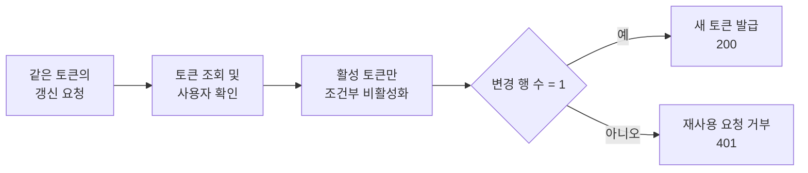
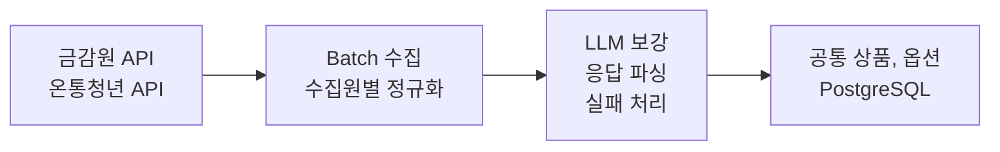
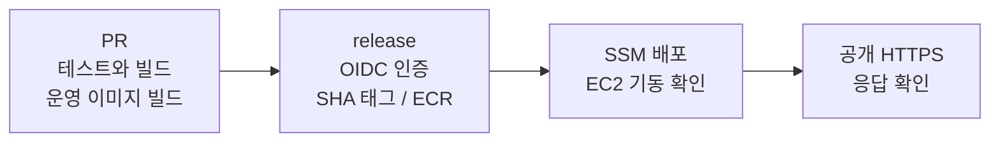
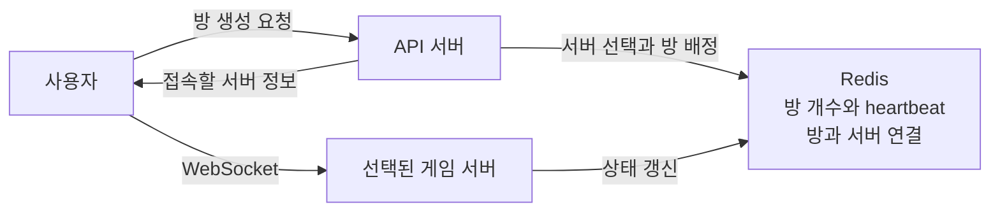

# 최유렬 | Backend Developer Portfolio

Java와 Spring으로 서비스 API와 데이터 수집기를 개발했습니다. 토큰 갱신 요청이 겹쳐 발생한 오류를 수정하고, 배포 환경 차이로 생긴 빌드 실패를 재현해 CI를 보완했습니다. 실시간 게임에서는 API와 게임 서버의 역할을 나누고 Redis로 서버 상태와 방 배정을 관리했습니다.

[GitHub](https://github.com/yuyeol3) / [개발 블로그](https://yuyeol3.github.io/)

## 핵심 경험

| 경험 | 직접 수행한 일 | 확인한 결과 |
| --- | --- | --- |
| Y-Fin | Refresh Token 동시성 수정, 금융 데이터 수집과 정규화, LLM 호출 실험 | 토큰 갱신 10개 요청에서 성공 1건, 401 응답 9건. 동일한 금융상품 97건의 배치 시간 38~48% 단축 |
| 카카오테크캠퍼스 | PR 검증과 ECR, SSM 배포 경로 구축, Docker 빌드 실패 대응 | 배포에서만 발견되던 오류를 PR 단계에서 재현하고, 수정 후 3개 구성요소 빌드 통과 |
| Yacht Online | API와 게임 서버 역할 분리, Redis 기반 서버 선택, EC2 배포 | Docker Compose 통합 실행 후 게임 서버 2대를 AWS에 배포. 10초 heartbeat와 30초 TTL로 서버 상태 관리 |

## 지원 직무와 연결되는 역량

| 직무에서 요구하는 역량 | 프로젝트 근거 |
| --- | --- |
| Java, Spring Boot, REST API, 인증과 보안 | Y-Fin의 OAuth2, JWT, Spring Security 인증, 사용자와 상품 API |
| 관계형 DB와 데이터 처리 | PostgreSQL과 JPA를 이용한 토큰 상태 변경, Spring Batch 외부 API 수집과 정규화 |
| Redis 활용 | Yacht의 서버별 방 개수 관리, heartbeat와 TTL을 이용한 서버 선택, 방과 서버의 연결 정보 저장 |
| AWS, 컨테이너, CI/CD | 카테캠의 EC2, Docker Compose, GitHub Actions, ECR, SSM 배포 |
| 안정성과 성능 개선 | 토큰 중복 갱신 방지, LLM 배치 지연 분석, 배포 환경 차이 재현, heartbeat가 끊긴 서버를 선택 후보에서 제외 |
| Git 협업과 배포 관리, 테스트 | 팀 PR에 테스트와 이미지 빌드 적용, 커밋 SHA 기반 이미지 추적, 수정 전후 실행 기록 |

## 목차

1. [Y-Fin](#1-y-fin): 토큰 갱신 동시성 / 외부 금융 데이터 처리
2. [카카오테크캠퍼스 팀 프로젝트](#2-카카오테크캠퍼스-팀-프로젝트): 배포 실패 재현과 CI 보완
3. [Yacht Online](#3-yacht-online): 서버 역할 분리 / Redis 기반 서버 선택 / EC2 배포

---

## 1. Y-Fin

**사용자의 소득, 나이, 가구 조건에 맞는 금융상품을 찾고 우대금리 조건을 확인하는 서비스**

| 항목 | 내용 |
| --- | --- |
| 기간 / 인원 | 2026.03 ~ 진행 중 / 5인 팀, 백엔드 2인 |
| 본인 역할 | 인증과 인가 기반 및 데이터 수집기 구축, 상품과 공급자 API 개발, 추천 로직 유지보수와 리팩터링 |
| 주요 기술 | Java 21, Spring Boot, Spring Security, JPA, Spring Batch, PostgreSQL, Gemini |
| 데이터 범위 | 은행상품 328건 + 정부 정책상품 63건, 총 391건 정규화 |
| 수상 | 제7회 PNU 창의융합AI해커톤 창업트랙 최우수상 |
| 코드 | [서비스 백엔드](https://github.com/ApptiveDev/Fin-BE) / [수집기](https://github.com/ApptiveDev/Fin-API) / [해커톤 버전](https://github.com/PNU-2026-AI-Hackathon/pnuai-c-07-finfin2) |

### 토큰 갱신 요청이 겹칠 때 발생한 500 오류

같은 Refresh Token으로 갱신 요청이 겹치면 두 요청이 모두 기존 토큰을 조회했습니다. 이후 토큰을 삭제하고 재발급하는 과정에서 충돌이 발생해 500 오류가 반환됐습니다.

이를 해결하기 위해 `isActive = true`인 토큰만 비활성화하는 UPDATE를 실행하고, 변경한 행 수가 1개인 요청에만 새 토큰을 발급했습니다. 토큰 조회 이후 다른 요청이 먼저 처리했더라도, DB 상태를 실제로 바꾼 요청만 재발급을 진행하도록 한 것입니다.

수정 후 10개 요청을 실행해 **200 응답 1건과 401 응답 9건**을 확인했습니다. 이미 사용한 토큰으로 들어온 요청은 500 오류 대신 인증 실패로 처리됐습니다. 해당 실행 결과와 코드를 PR에 남겼습니다.

[동시성 수정과 요청 결과](https://github.com/ApptiveDev/Fin-BE/pull/9) / [인증 기반 구현](https://github.com/ApptiveDev/Fin-BE/pull/3) / [인가 예외 처리](https://github.com/ApptiveDev/Fin-BE/pull/11)

### 금융 데이터 정규화에서 발생한 timeout과 파싱 실패

외부 API마다 데이터 구조가 달랐고, 우대금리의 일부 조건은 줄글로 제공됐습니다. 수집원별 데이터를 공통 상품과 옵션 모델로 정규화하고, 줄글 조건은 LLM으로 구조화했습니다. 수집 대상에서 사라진 상품은 비활성화하도록 동기화도 구현했습니다.

이 과정에서 일부 LLM 호출이 약 60초 뒤 timeout으로 끝나거나 응답 파싱에 실패했습니다. 배치 전체 시간만으로는 어떤 상품의 호출이 지연되는지 알기 어려워 상품별 호출 시간과 성공 여부를 기록했습니다.

동일한 FSS 원본 97건으로 temperature와 출력 토큰 상한 조합을 비교한 뒤 `temperature=0.3`, `max_output_tokens=2048`을 적용했습니다. 이 설정에서 배치 시간은 5분 30초에서 2분 52초~3분 23초로 줄었지만 파싱 실패는 남아 있었습니다.

남은 실패를 줄이기 위해 포괄 조건과 실제 우대 조건을 구분하고, 구간별 차등 금리를 별도 항목으로 추출하도록 프롬프트를 보완했습니다. 응답을 감싼 코드펜스를 제거하고 누락 필드는 기본값으로 처리했습니다. 실패한 상품을 계속 호출하지 않도록 6시간 재시도 쿨다운도 두었습니다.

| 검증 단계 | 변경 전 | 변경 후 | 해석 범위 |
| --- | --- | --- | --- |
| 설정 조합 비교 | 97건 배치 5분 30초, 실패 4건 | 선택 설정의 3회 실행 2분 52초~3분 23초, 실패 4~5건 | 전체 시간 약 38~48% 단축. 이 단계에서 파싱 실패는 남아 있었음 |
| 프롬프트 보완 | 우대조건 파싱 실패 | 7차례 개선 후 동일한 97건에서 파싱 실패 0건 | 조정에 사용한 데이터의 회귀 검증 |

temperature와 출력 상한을 함께 바꾼 실험이라 각 설정의 효과를 따로 구분할 수는 없습니다. 프롬프트 수정 후에는 같은 97건에서 파싱 실패가 0건이었으며, 새 상품에 대한 검증은 별도로 필요합니다. 수집기에는 실제 PostgreSQL을 사용하는 Testcontainers 통합 테스트를 구성했습니다.

[설정별 실행 결과와 프롬프트 수정](https://github.com/PNU-2026-AI-Hackathon/pnuai-c-07-finfin2/pull/40) / [97건 검토 자료](https://github.com/user-attachments/files/32417255/fss_normalization_v7_review.xlsx) / [상품 동기화 구현](https://github.com/ApptiveDev/Fin-API/pull/1)

---

## 2. 카카오테크캠퍼스 팀 프로젝트

**개인사업자의 카드 승인내역을 받아 필요경비 인정 여부와 근거를 제공하는 서비스**

| 항목 | 내용 |
| --- | --- |
| 기간 / 인원 | 2026.09 ~ 진행 중 / 6인 팀, 백엔드 2인 |
| 본인 역할 | 백엔드 개발, CI/CD 및 AWS 배포 기반 구축 |
| 주요 기술 | Java 21, Spring Boot, PostgreSQL, GitHub Actions, Docker Compose, AWS EC2, ECR, SSM, IAM, Caddy |
| 현재 단계 | 팀 서비스 개발 중. EC2 배포 경로 및 스택 기동을 확인했으며 서비스 전체 기능 완성은 진행 중 |
| 코드 | [팀 저장소](https://github.com/kakaotechcampus-4/ktc4-pusan-4) |

### CI는 통과했지만 배포 이미지 빌드가 실패한 원인

2026년 10월 5일, PR의 테스트와 웹 빌드는 통과했지만 release 배포에서 웹 Docker 이미지 빌드가 실패했습니다. 프런트 빌드가 읽는 `rules/categories.yaml`이 이미지에 없었습니다. CI 러너에는 저장소 전체가 있었지만 Dockerfile은 `frontend/`만 복사하고 있어 빌드 조건이 달랐습니다. 이미지 빌드 단계에서 멈췄기 때문에 EC2의 기존 버전은 유지됐습니다.

누락 파일을 추가하기 전에, 백엔드와 AI, 웹을 **배포와 같은 Dockerfile 및 빌드 컨텍스트로 PR에서 빌드**하도록 CI를 바꿨습니다. 이 변경만 반영했을 때 기존 `npm run build`는 통과했지만 새 `Build production image` 단계는 배포와 같은 오류로 실패했습니다. 추가한 검증이 실제로 파일 누락을 잡는다는 것을 확인한 뒤 Dockerfile에 카테고리 원본을 복사하도록 수정했습니다. 이후 세 이미지 빌드가 모두 통과했고 같은 날 release 배포도 성공했습니다.

이미지 빌드를 추가하면서 CI 시간은 늘었습니다. 한 차례의 전후 비교에서 가장 오래 걸린 백엔드 job은 1분 18초에서 1분 56초로 증가했습니다. 이 시간을 들여 배포에서 발생할 빌드 오류를 PR 단계에서 확인하도록 했습니다.

배포 경로도 직접 구축했습니다. GitHub OIDC로 AWS 임시 자격증명을 받고 SSM으로 EC2의 배포 스크립트를 실행했습니다. 이미지에는 커밋 SHA를 붙여 버전을 추적하고, `flock`으로 배포를 한 번에 하나씩 실행하도록 했습니다. 최신 release SHA와 다른 오래된 배포 요청은 거부했습니다.

Compose 기동 대기와 공개 HTTPS 응답 확인을 배포 과정에 넣었고, 이전 SHA를 지정하는 롤백 명령도 마련했습니다. 다만 이미지 롤백으로 DB 스키마까지 복원되지는 않아 스키마 복원은 별도로 처리해야 합니다.

[빌드 오류 수정 PR](https://github.com/kakaotechcampus-4/ktc4-pusan-4/pull/89) / [오류를 재현한 CI 실행](https://github.com/kakaotechcampus-4/ktc4-pusan-4/actions/runs/37260200228) / [수정 후 성공한 CI 실행](https://github.com/kakaotechcampus-4/ktc4-pusan-4/actions/runs/37260380195)

[배포 워크플로](https://github.com/kakaotechcampus-4/ktc4-pusan-4/blob/develop/.github/workflows/aws-release.yml) / [배포 스크립트](https://github.com/kakaotechcampus-4/ktc4-pusan-4/blob/develop/deploy/deploy.sh)

---

## 3. Yacht Online

**최대 4명이 한 방에서 함께 플레이하는 실시간 주사위 게임**

| 항목 | 내용 |
| --- | --- |
| 기간 / 인원 | 2026.02 ~ 2026.06 / 3인 팀, 클라우드컴퓨팅 과제 |
| 본인 역할 | 백엔드 구조 개선, API와 게임 서버 역할 분리, Redis 연동, Docker Compose 통합 실행, EC2 배포 및 RDS와 ALB 연동 |
| 주요 기술 | Java, Spring Boot, WebSocket(STOMP), Redis, Docker Compose, AWS EC2 |
| 구현 범위 | 게임 서버 2대, 방당 최대 4명, 3분 턴 제한 |
| 코드 | [통합 저장소](https://github.com/yuyeol3/yacht-online) / [백엔드 저장소](https://github.com/yuyeol3/yacht-backend/tree/feat/seperate-game-api) |

### API와 게임 서버의 역할을 나누고 서버를 선택하는 구조

로컬에서 동작하던 게임을 여러 게임 서버로 배포하면서, 사용자가 어느 서버에 접속해야 하는지 결정할 필요가 생겼습니다. 방을 만든 뒤에는 참가자들이 같은 서버에 연결돼야 하고, 응답이 끊긴 서버는 새 방을 배정할 때 제외해야 했습니다.

하나의 Spring Boot 코드베이스에서 실행 프로필과 조건부 컴포넌트 설정으로 API 서버와 게임 서버의 역할을 나눴습니다. 인증과 일반 REST 요청은 API 서버가 처리하고, 방에 연결된 사용자의 실시간 메시지와 게임 진행 상태는 게임 서버가 관리하도록 했습니다.

Redis Sorted Set에는 서버별 방 개수를 기록했습니다. API 서버는 방 개수가 적은 순서로 후보를 확인하고, 서버 상태 키가 남아 있는 서버를 선택합니다. 새 방을 만들면 방과 서버의 연결 정보를 저장하고 해당 서버의 방 개수를 늘립니다. 이후 같은 방으로 들어오는 요청은 저장된 서버 정보를 사용하도록 했습니다.

게임 서버는 10초마다 heartbeat를 갱신하고, 서버 상태 키에 30초 TTL을 적용했습니다. 갱신이 끊겨 키가 만료된 서버는 새 방을 배정할 때 후보에서 제외합니다. Redis에는 서버 선택과 방 배정에 필요한 정보를 두고, 진행 중인 게임 상태는 해당 게임 서버가 관리하도록 구분했습니다.

[서버 역할을 나눈 커밋](https://github.com/yuyeol3/yacht-backend/commit/eb6515c) / [서버 선택과 방 배정 코드](https://github.com/yuyeol3/yacht-backend/blob/865dd4056a69ab2da8875b1a9194779c79333096/src/main/java/io/github/yuyeol3/yachtbackend/server/GameServerRegistryService.java) / [heartbeat 갱신 코드](https://github.com/yuyeol3/yacht-backend/blob/865dd4056a69ab2da8875b1a9194779c79333096/src/main/java/io/github/yuyeol3/yachtbackend/server/GameServerHeartbeat.java)

### 방 단위 상태 동기화와 클라우드 배포

게임 중 발생하는 주사위 굴리기, 고정과 해제, 점수 선택, 턴 전환은 서버에서 현재 턴과 게임 규칙을 확인한 뒤 처리했습니다. 처리한 상태는 STOMP로 같은 방의 참가자들에게 전달했습니다. 방당 최대 4명과 3분 턴 제한을 서버 규칙으로 적용했습니다.

Docker Compose로 API 서버와 게임 서버, Redis를 함께 실행해 연동을 확인한 뒤 게임 서버 2대를 AWS EC2에 배포했습니다. 본인은 백엔드와 게임 서버, Redis, EC2 배포를 담당했습니다. RDS 구성과 스키마 이식은 다른 팀원이 맡았고, S3 정적 호스팅과 인증서, DNS, ALB 구성도 해당 담당자가 진행했습니다. 저는 배포한 백엔드가 RDS와 ALB에 연동되도록 설정했습니다.

이 프로젝트에서 확인한 범위는 서버 역할 분리와 상태 동기화, 클라우드 환경 구축과 배포입니다. 처리량 증가나 장기 운영 실적은 별도로 측정하지 않았습니다.

[게임 액션 처리 코드](https://github.com/yuyeol3/yacht-backend/blob/865dd4056a69ab2da8875b1a9194779c79333096/src/main/java/io/github/yuyeol3/yachtbackend/game/GameController.java) / [프로젝트 구성도](https://github.com/yuyeol3/yacht-online/blob/main/docs/images/diagram.png) / [팀 역할과 배포 기록](https://github.com/yuyeol3/yacht-online#readme)

