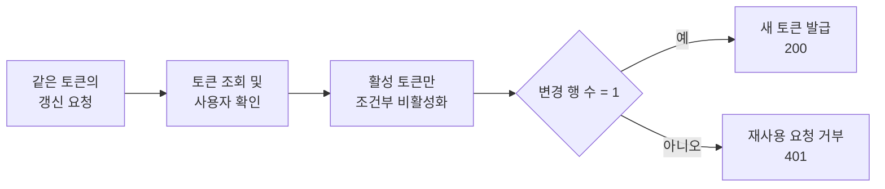
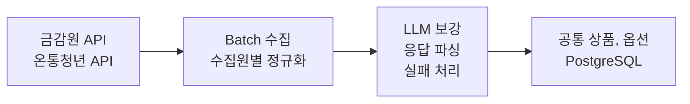
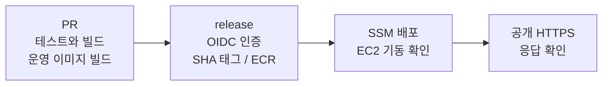
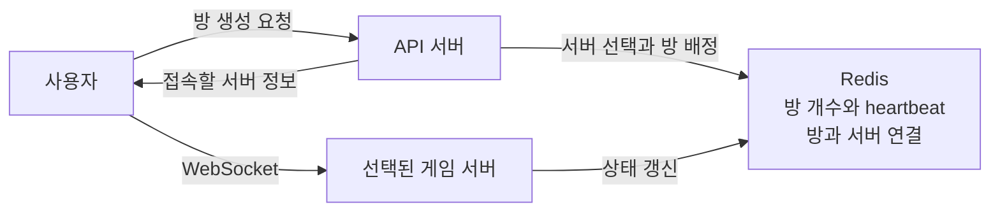

# 최유렬 | Backend Developer Portfolio

Java와 Spring을 기반으로 서비스 API와 데이터 수집 파이프라인을 개발했습니다. 동시 요청으로 발생한 토큰 갱신 오류를 조건부 업데이트로 해결하고, 실행 환경 차이로 발생한 빌드 실패를 PR 단계에서 재현하도록 CI를 보완했습니다. 실시간 게임 프로젝트에서는 API 서버와 게임 서버의 역할을 분리하고, Redis를 활용해 서버 상태 확인과 방 배정을 구현했습니다.

[GitHub](https://github.com/yuyeol3) / [개발 블로그](https://yuyeol3.github.io/)

## 핵심 경험

| 경험 | 직접 수행한 일 | 확인한 결과 |
| --- | --- | --- |
| Y-Fin | Refresh Token 동시성 오류 수정, 금융 데이터 수집·정규화, LLM 호출 실험 | 동시 토큰 갱신 요청 10건 중 성공 1건·401 응답 9건 확인 / 동일 금융상품 97건 배치 소요 시간 38~48% 단축 |
| 카카오테크캠퍼스 | PR 검증 및 ECR·SSM 배포 경로 구축, Docker 빌드 실패 대응 | 배포 시점에만 드러나던 오류를 PR 단계에서 재현하고, 수정 후 3개 구성요소 이미지 빌드 통과 |
| Yacht Online | API·게임 서버 역할 분리, Redis 기반 서버 선택, EC2 배포 | Docker Compose 통합 검증 후 게임 서버 2대 AWS 배포 / 10초 heartbeat와 30초 TTL로 서버 상태 관리 |

## 역량별 프로젝트 근거

| 역량 | 프로젝트 근거 |
| --- | --- |
| Java, Spring Boot, REST API, 인증·보안 | Y-Fin의 OAuth2, JWT, Spring Security 기반 인증 및 사용자·상품 API 개발 |
| 관계형 DB와 데이터 처리 | PostgreSQL·JPA 기반 토큰 상태의 원자적 변경, Spring Batch를 활용한 외부 API 수집 및 정규화 |
| Redis 활용 | Yacht Online의 서버별 방 개수 관리, heartbeat·TTL 기반 활성 서버 선택, 방-서버 매핑 정보 관리 |
| AWS, 컨테이너, CI/CD | 카테캠 프로젝트의 EC2, Docker Compose, GitHub Actions, ECR, SSM 배포 자동화 |
| 안정성과 성능 개선 | 토큰 중복 갱신 방지, LLM 배치 지연 분석 및 단축, 배포 환경 차이 재현, 비정상 서버의 배정 후보 제외 |
| Git 협업과 배포 관리, 테스트 | 팀 PR에 테스트 및 운영 이미지 빌드 적용, 커밋 SHA 기반 이미지 추적, 수정 전후 실행 로그 기록 |

## 목차

1. [Y-Fin](#1-y-fin): 토큰 갱신 동시성 제어 / 외부 금융 데이터 처리
2. [카카오테크캠퍼스 팀 프로젝트](#2-카카오테크캠퍼스-팀-프로젝트): 배포 실패 재현과 CI 보완
3. [Yacht Online](#3-yacht-online): 서버 역할 분리 / Redis 기반 서버 선택 / EC2 배포

---

## 1. Y-Fin

**사용자의 소득, 나이, 가구 조건에 맞는 금융상품을 찾고 우대금리 조건을 확인하는 서비스**

| 항목 | 내용 |
| --- | --- |
| 기간 / 인원 | 2026.03 ~ 진행 중 / 5인 팀 (백엔드 2인) |
| 본인 역할 | 인증·인가 기반 및 데이터 수집기 구축, 상품·공급자 API 개발, 추천 로직 유지보수 및 리팩터링 |
| 주요 기술 | Java 21, Spring Boot, Spring Security, JPA, Spring Batch, PostgreSQL, Gemini |
| 데이터 범위 | 은행상품 328건 + 정부 정책상품 63건, 총 391건 정규화 |
| 수상 | 제7회 PNU 창의융합AI해커톤 창업트랙 최우수상 |
| 코드 | [서비스 백엔드](https://github.com/ApptiveDev/Fin-BE) / [수집기](https://github.com/ApptiveDev/Fin-API) / [해커톤 버전](https://github.com/PNU-2026-AI-Hackathon/pnuai-c-07-finfin2) |

### 토큰 갱신 요청이 겹칠 때 발생한 500 오류 해결

동일한 Refresh Token으로 갱신 요청이 동시에 들어올 때, 두 요청 모두 기존 토큰을 유효한 상태로 조회하는 문제가 있었습니다. 이후 각 요청이 토큰을 비활성화하고 재발급하는 과정에서 충돌이 발생해 `500` 오류가 반환되었습니다.

이를 해결하기 위해 `isActive = true`인 토큰만 비활성화하는 조건부 UPDATE 쿼리를 실행하고, 변경된 행의 수(Affected Rows)가 1인 요청에만 새 토큰을 발급하도록 수정했습니다. 조회 시점에는 토큰이 활성 상태였더라도, 실제로 DB 상태를 변경한 단 하나의 요청만 재발급을 진행하도록 보장한 것입니다.

수정 후 10개의 동시 갱신 요청을 전송한 결과, **200 응답 1건과 401 응답 9건**을 확인했습니다. 이미 사용된 토큰으로 들어온 후속 요청은 500 오류 대신 의도한 인증 실패(401)로 처리되었으며, 해당 실행 결과와 코드를 PR에 기록했습니다.

[동시성 수정과 요청 결과](https://github.com/ApptiveDev/Fin-BE/pull/9) / [인증 기반 구현](https://github.com/ApptiveDev/Fin-BE/pull/3) / [인가 예외 처리](https://github.com/ApptiveDev/Fin-BE/pull/11)

### 금융 데이터 정규화에서 발생한 timeout과 파싱 실패 개선

외부 API마다 응답 데이터 구조가 달랐고, 우대금리의 일부 조건은 비정형 줄글로 제공되었습니다. 이에 수집원별 데이터를 공통 상품·옵션 모델로 정규화하고, 줄글로 된 조건은 LLM을 호출해 구조화했습니다. 또한 수집 대상에서 제외된 상품은 비활성화 처리하도록 동기화 로직을 구현하고, 실제 PostgreSQL을 사용하는 Testcontainers 통합 테스트로 수집기를 검증했습니다.

데이터를 처리하는 과정에서 일부 LLM 호출이 약 60초 뒤 timeout으로 종료되거나 응답 파싱에 실패하는 문제가 발생했습니다. 배치 전체 소요 시간만으로는 어느 구간에서 지연되는지 파악하기 어려워, 상품별 호출 시간과 성공 여부를 로그로 기록해 원인을 분석했습니다.

동일한 금감원(FSS) 원본 데이터 97건을 기준으로 `temperature`와 출력 토큰 상한 조합을 비교 실험한 뒤, `temperature=0.3`, `max_output_tokens=2048` 설정을 적용했습니다. 이 설정을 통해 전체 배치 시간은 5분 30초에서 2분 52초~3분 23초로 단축되었으나, 파싱 실패는 여전히 남아 있었습니다.

남은 파싱 실패를 해결하기 위해 포괄 조건과 실제 우대 조건을 구분하고, 구간별 차등 금리를 별도 항목으로 추출하도록 프롬프트를 구체화했습니다. 또한 응답을 감싼 마크다운 코드펜스를 제거하고 누락된 필드는 기본값으로 처리하도록 파서를 보완했으며, 실패한 상품을 반복 호출하지 않도록 6시간의 재시도 쿨다운을 두었습니다.

| 검증 단계 | 변경 전 | 변경 후 | 해석 범위 |
| --- | --- | --- | --- |
| 설정 조합 비교 | 97건 배치 5분 30초, 실패 4건 | 선택 설정 3회 실행 시 2분 52초\~3분 23초, 실패 4\~5건 | 전체 시간 약 38~48% 단축 (파싱 실패는 잔존) |
| 프롬프트 및 파서 보완 | 우대조건 파싱 실패 발생 | 7차례 개선 후 동일한 97건에서 파싱 실패 0건 | 조정에 사용한 데이터셋 기준 회귀 검증 완료 |

`temperature`와 출력 토큰 상한을 함께 변경한 실험이므로 두 설정 각각의 개별 효과를 분리해 단정할 수는 없습니다. 또한 프롬프트 수정 후 동일한 97건에서는 파싱 실패가 0건이었으나, 향후 새로 유입되는 상품 데이터에 대해서는 별도의 검증이 필요합니다.

[설정별 실행 결과와 프롬프트 수정](https://github.com/PNU-2026-AI-Hackathon/pnuai-c-07-finfin2/pull/40) / [97건 검토 자료](https://github.com/user-attachments/files/32417255/fss_normalization_v7_review.xlsx) / [상품 동기화 구현](https://github.com/ApptiveDev/Fin-API/pull/1)

---

## 2. 카카오테크캠퍼스 팀 프로젝트

**개인사업자의 카드 승인내역을 받아 필요경비 인정 여부와 근거를 제공하는 서비스**

| 항목 | 내용 |
| --- | --- |
| 기간 / 인원 | 2026.09 ~ 진행 중 / 6인 팀 (백엔드 2인) |
| 본인 역할 | 백엔드 개발, CI/CD 및 AWS 배포 기반 구축 |
| 주요 기술 | Java 21, Spring Boot, PostgreSQL, GitHub Actions, Docker Compose, AWS EC2, ECR, SSM, IAM, Caddy |
| 현재 단계 | 팀 서비스 개발 중 (EC2 배포 경로 및 전체 스택 기동 확인 완료, 세부 기능 개발 진행 중) |
| 코드 | [팀 저장소](https://github.com/kakaotechcampus-4/ktc4-pusan-4) |

### CI는 통과했지만 배포 이미지 빌드가 실패한 원인 분석과 보완

2026년 10월 5일, PR 단계의 테스트와 웹 빌드는 통과했으나 release 배포 과정에서 웹 Docker 이미지 빌드가 실패했습니다. 원인은 프런트엔드 빌드 시 참조하는 `rules/categories.yaml` 파일이 컨테이너 이미지 내부에 없었기 때문입니다. CI 러너에는 저장소 전체 파일이 존재해 빌드가 성공했지만, Dockerfile은 `frontend/` 디렉터리만 복사하고 있어 실제 이미지 빌드 환경과 조건이 달랐습니다. 이미지 빌드 단계에서 배포가 중단되었기 때문에 EC2에서 실행 중이던 기존 버전은 그대로 유지되었습니다.

누락된 파일을 바로 추가하기에 앞서, 백엔드·AI·웹 모두 **운영 배포와 동일한 Dockerfile 및 빌드 컨텍스트로 PR 단계에서 이미지를 빌드**하도록 CI 워크플로를 먼저 수정했습니다. 이 변경만 적용했을 때 기존의 `npm run build`는 통과했지만, 새로 추가한 `Build production image` 단계는 실제 배포 때와 동일한 오류로 실패했습니다. 추가한 검증 단계가 파일 누락을 정확히 잡아내는 것을 확인한 뒤, Dockerfile에 카테고리 원본 파일을 복사하도록 수정했습니다. 이후 세 구성요소의 이미지 빌드가 모두 통과했고 당일 release 배포도 성공적으로 마쳤습니다.

운영 이미지 빌드 검증을 추가하면서 CI 실행 시간은 다소 늘어났습니다. 전후 실행 기록을 비교했을 때 가장 오래 걸리는 백엔드 job은 1분 18초에서 1분 56초로 증가했으나, 약 38초의 시간을 더 들여 배포 시점에 발생할 빌드 오류를 PR 단계에서 사전에 차단하도록 개선했습니다.

배포 자동화 경로도 직접 구축했습니다. GitHub OIDC로 AWS 임시 자격증명을 발급받고, SSM을 통해 EC2 내부의 배포 스크립트를 실행하는 구조입니다. 이미지에는 커밋 SHA 태그를 부여해 버전을 추적하고, `flock`을 이용해 동시 배포를 방지하며 순차적으로 실행되도록 제어했습니다. 또한 최신 release SHA와 일치하지 않는 이전 버전의 배포 요청은 거부하도록 구성했습니다.

배포 스크립트에는 Docker Compose 기동 대기 및 공개 HTTPS 응답 확인 절차를 포함했고, 이전 커밋 SHA를 지정해 되돌리는 롤백 명령도 마련했습니다. 다만 컨테이너 이미지 롤백만으로는 DB 스키마 변경 사항까지 복원되지 않으므로, 스키마 복원은 별도로 처리해야 합니다.

[빌드 오류 수정 PR](https://github.com/kakaotechcampus-4/ktc4-pusan-4/pull/89) / [오류를 재현한 CI 실행](https://github.com/kakaotechcampus-4/ktc4-pusan-4/actions/runs/37260200228) / [수정 후 성공한 CI 실행](https://github.com/kakaotechcampus-4/ktc4-pusan-4/actions/runs/37260380195)

[배포 워크플로](https://github.com/kakaotechcampus-4/ktc4-pusan-4/blob/develop/.github/workflows/aws-release.yml) / [배포 스크립트](https://github.com/kakaotechcampus-4/ktc4-pusan-4/blob/develop/deploy/deploy.sh)

---

## 3. Yacht Online

**최대 4명이 한 방에서 함께 플레이하는 실시간 주사위 게임**

| 항목 | 내용 |
| --- | --- |
| 기간 / 인원 | 2026.02 ~ 2026.06 / 3인 팀 (클라우드컴퓨팅 과제) |
| 본인 역할 | 백엔드 구조 개선, API·게임 서버 역할 분리, Redis 연동, Docker Compose 통합 실행, EC2 배포 및 RDS·ALB 연동 |
| 주요 기술 | Java, Spring Boot, WebSocket(STOMP), Redis, Docker Compose, AWS EC2 |
| 구현 범위 | 게임 서버 2대, 방당 최대 4명, 3분 턴 제한 |
| 코드 | [통합 저장소](https://github.com/yuyeol3/yacht-online) / [백엔드 저장소](https://github.com/yuyeol3/yacht-backend/tree/feat/seperate-game-api) |

### API와 게임 서버의 역할을 나누고 서버를 선택하는 구조

로컬 단일 서버에서 동작하던 게임을 여러 대의 게임 서버로 확장 배포하면서, 사용자를 어느 게임 서버로 연결할지 결정하는 구조가 필요해졌습니다. 방이 생성된 이후에는 같은 방의 참가자들이 모두 동일한 게임 서버에 접속해야 하며, 응답이 끊긴 서버는 새 방 배정 후보에서 제외해야 했습니다.

이를 위해 하나의 Spring Boot 코드베이스 내에서 실행 프로필과 조건부 컴포넌트 설정(`@ConditionalOnProperty` 등)을 활용해 API 서버와 게임 서버의 역할을 분리했습니다. 인증과 일반 REST 요청은 API 서버가 처리하고, 방에 입장한 사용자 간의 실시간 웹소켓 메시지와 인게임 진행 상태는 게임 서버가 전담하도록 구성했습니다.

서버별 활성 방 개수는 Redis Sorted Set에 기록했습니다. API 서버는 방 개수가 적은 순서대로 후보 서버를 조회한 뒤, 활성 상태 키(heartbeat)가 유효한 서버를 최종 선택합니다. 새 방이 생성되면 방과 서버의 매핑 정보를 Redis에 저장하고 해당 서버의 방 개수를 증가시킵니다. 이후 같은 방에 입장하는 후속 요청은 Redis에 저장된 매핑 정보를 조회해 동일한 게임 서버로 안내받게 됩니다.

각 게임 서버는 10초 주기로 heartbeat를 갱신하며, 상태 키에는 30초의 TTL을 설정했습니다. 서버 장애 등으로 갱신이 중단되어 키가 만료된 서버는 새 방 배정 후보에서 자연스럽게 제외됩니다. 즉, Redis에는 서버 선택과 방 라우팅에 필요한 메타데이터만 두고, 실제 진행 중인 게임의 세부 상태는 배정된 게임 서버 메모리가 직접 관리하도록 책임을 나눴습니다.

[서버 역할을 나눈 커밋](https://github.com/yuyeol3/yacht-backend/commit/eb6515c) / [서버 선택과 방 배정 코드](https://github.com/yuyeol3/yacht-backend/blob/865dd4056a69ab2da8875b1a9194779c79333096/src/main/java/io/github/yuyeol3/yachtbackend/server/GameServerRegistryService.java) / [heartbeat 갱신 코드](https://github.com/yuyeol3/yacht-backend/blob/865dd4056a69ab2da8875b1a9194779c79333096/src/main/java/io/github/yuyeol3/yachtbackend/server/GameServerHeartbeat.java)

### 방 단위 상태 동기화와 클라우드 배포

게임 중 발생하는 주사위 굴리기, 주사위 고정·해제, 점수판 선택, 턴 전환 등의 액션은 게임 서버에서 현재 턴 소유자와 게임 규칙을 검증한 뒤 처리했습니다. 변경된 상태는 STOMP를 통해 같은 방을 구독 중인 참가자들에게 브로드캐스트했으며, 방당 최대 4명 인원 제한과 3분 턴 제한 규칙을 서버 측에서 제어했습니다.

로컬에서 Docker Compose로 API 서버, 게임 서버, Redis를 통합 실행해 연동을 검증한 뒤, AWS EC2에 게임 서버 2대를 포함한 백엔드 환경을 배포했습니다. 클라우드 인프라 구축 과정에서는 팀원들이 구성한 RDS(스키마 이식) 및 S3·ALB·DNS 환경에 맞춰, 제가 배포한 백엔드와 게임 서버, Redis가 RDS 및 ALB와 정상적으로 통신하도록 연동 설정을 마무리했습니다.

[게임 액션 처리 코드](https://github.com/yuyeol3/yacht-backend/blob/865dd4056a69ab2da8875b1a9194779c79333096/src/main/java/io/github/yuyeol3/yachtbackend/game/GameController.java) / [프로젝트 구성도](https://github.com/yuyeol3/yacht-online/blob/main/docs/images/diagram.png) / [팀 역할과 배포 기록](https://github.com/yuyeol3/yacht-online#readme)
